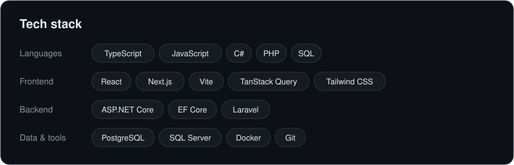

  

  

  

## What I'm building

**FitTrack** is a fitness tracker with an exercise library, workout logging, progress
charts, fitness calculators and an admin console.

| Part | Built with | Code |
| --- | --- | --- |
| Web app | React, TypeScript, TanStack Query, Tailwind CSS | [fittrack-frontend](https://github.com/NitroDaxs/fittrack-frontend) |
| API | ASP.NET Core, EF Core, PostgreSQL, Onion architecture | [fittrack-be-cs](https://github.com/NitroDaxs/fittrack-be-cs) |
